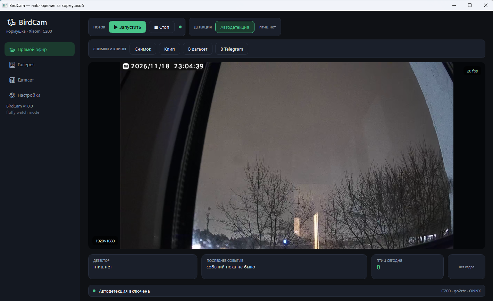

# BirdCam

Приложение для наблюдения за птицами у кормушки через камеру Xiaomi C200:
живое видео, снимки и клипы, детекция птиц (YOLO/ONNX), накопление датасета
и отправка фото в Telegram.



## Возможности

- Прямой эфир с RTSP-потока go2rtc (HEVC 1080p) и рамки детекций поверх видео.
- Снимки в JPEG и клипы в MP4 (H.264/AAC) через ffmpeg.
- Автодетекция YOLO26m ONNX: DirectML (AMD/NVIDIA/Intel) или CPU.
- Датасет: кадры, YOLO-разметка и кропы птиц; статистика и экспорт в ZIP.
- Галерея: просмотр, открытие файла/папки, удаление, отправка в Telegram.
- SQLite: история файлов, детекций и примеров датасета.

Стек: .NET 10 WPF (MVVM), EF Core/SQLite, OpenCV, ONNX Runtime, ffmpeg, Telegram.Bot.
Слои: `BirdCam.Domain` → `BirdCam.Application` → `BirdCam.Infrastructure` → `BirdCam.UI`.

## Требования

- Windows 10/11 и .NET 10 SDK.
- [go2rtc](https://github.com/AlexxIT/go2rtc) с потоком камеры
  (по умолчанию `rtsp://127.0.0.1:8554/c200`; для C200 HD нужен `subtype=3`).
  BirdCam запускает его вместе с приложением и останавливает при выходе;
  путь к `go2rtc.exe` можно указать в настройках, пустой — автопоиск в PATH и типовых папках.
- ffmpeg (winget-версия находится автоматически, путь можно задать в настройках).
- ONNX-модель в `models/` — в репозиторий веса не коммитятся.

## Запуск

```powershell
dotnet build BirdCam.slnx
dotnet run --project BirdCam.UI
```

`run-quiet.cmd` запускает приложение без предупреждений HEVC-декодера в консоли.

Экспорт модели (нужен Python 3.12/3.13):

```powershell
py -3.13 -m venv .tools\venv
.\.tools\venv\Scripts\python.exe -m pip install ultralytics onnx onnxslim
cd models
..\.tools\venv\Scripts\python.exe -c "from ultralytics import YOLO; YOLO('yolo26m.pt').export(format='onnx', opset=18, imgsz=640)"
```

Доступны `yolo26n`, `yolo26s`, `yolo26m` (по умолчанию m) и `yolo11n`;
модель переключается в настройках.

## Настройка

Во вкладке «Настройки» задаются RTSP-адрес, модель, порог и интервал детекции,
путь к ffmpeg, путь и API go2rtc, токен и chat id Telegram. Доступность go2rtc
проверяется при старте и каждые 5 секунд; статус виден в панели «Поток».
Автодетекция включена по умолчанию: найденные птицы сохраняются в датасет
и (опционально) отправляются в Telegram.

Telegram: создайте бота у [@BotFather](https://t.me/BotFather), узнайте `chat_id`
через `getUpdates`, вставьте оба значения в настройках и нажмите тест.

## Данные

```
%LOCALAPPDATA%\BirdCam\
├── birdcam.db                  SQLite
├── settings.json               настройки (в т.ч. токен бота)
├── logs\                       логи
├── media\                      snapshots, clips, thumbs
├── models\                     ONNX-модели
└── dataset\                    data.yaml, images, labels, crops
```

## Дообучение

Датасет совместим с ultralytics:

```powershell
cd %LOCALAPPDATA%\BirdCam\dataset
yolo detect train data=data.yaml model=yolo26m.pt epochs=80 imgsz=640
yolo export model=runs/detect/train/weights/best.pt format=onnx opset=18
```

Положите `best.onnx` в `models`, выберите его в настройках и укажите
«Классы птиц» = `0`. Кропы из `crops\` удобны для обучения классификатора видов.

## Диагностика

```powershell
BirdCam.UI.exe --smoke                                  # кадр → детекция → снимок → датасет → клип
BirdCam.UI.exe --smoke --image C:\temp\bird.jpg         # детекция на картинке
BirdCam.UI.exe --ui-smoke                               # проверка загрузки страниц XAML
BirdCam.UI.exe --page gallery                           # открыть нужную страницу
```

Результаты пишутся в `%LOCALAPPDATA%\BirdCam\logs`.

## Примечания

- Сообщения `[hevc] Could not find ref with POC ...` — штатные предупреждения декодера
  при подключении с середины GOP; на видео не влияют. Подавляются `run-quiet.cmd`
  или переменными `OPENCV_FFMPEG_LOGLEVEL=8` и `OPENCV_FFMPEG_CAPTURE_OPTIONS=rtsp_transport;tcp`
  **до** запуска процесса.
- Одна камера и один поток. COCO-модель различает класс «bird», но не вид —
  для видов нужно дообучение на своих кропах.
- Если go2rtc уже запущен вручную, приложение использует его и не закрывает при выходе.
  Останавливается только экземпляр, запущенный самим BirdCam.
- Токен Xiaomi в go2rtc периодически истекает; Telegram принимает видео до 50 МБ.
- Не открывайте порты go2rtc (1984/8554/8555) в интернет: веб-интерфейс без пароля,
  а `settings.json` содержит токен бота.
