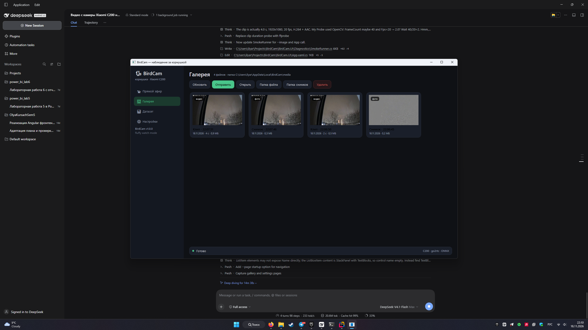

# BirdCam

Десктопное приложение для наблюдения за птицами у кормушки через камеру Xiaomi C200:
живой поток, снимки, клипы, автоматическая детекция птиц (ONNX/YOLO), накопление
датасета для дообучения и отправка фото в Telegram.


## Возможности

- **Прямой эфир** с RTSP-потока go2rtc (HEVC 1080p, ~20 fps), рамки детекций поверх видео.
- **Снимок** текущего кадра в JPEG, **клип** 3–120 секунд в MP4 (H.264 + AAC) через ffmpeg.
- **Автодетекция** в фоне: YOLO26m ONNX, DirectML (AMD/NVIDIA/Intel) или CPU.
- **Датасет**: каждый найденный кадр сохраняется как изображение + YOLO-разметка + кроп
  с птицей; есть ручное добавление, статистика, экспорт в ZIP.
- **Галерея**: снимки и клипы, открытие файла/папки, удаление, отправка в Telegram.
- **Telegram**: фото при обнаружении (опционально), ручная отправка из галереи, тест связи.
- **SQLite**: история файлов, детекций и примеров датасета.



## Стек и архитектура

| Слой | Проект | Ответственность |
|---|---|---|
| Domain | `BirdCam.Domain` | сущности, value objects (`VideoFrame`, `BoundingBox`), без зависимостей |
| Application | `BirdCam.Application` | сценарии, интерфейсы, настройки, пайплайн наблюдения |
| Infrastructure | `BirdCam.Infrastructure` | EF Core + SQLite, OpenCV, ONNX Runtime, ffmpeg, Telegram.Bot |
| UI | `BirdCam.UI` | WPF + MVVM (CommunityToolkit.Mvvm), DI через Generic Host |

- Захват кадров: OpenCV (`OpenCvFrameSource`), RTSP-источник — go2rtc.
- Детекция: `Microsoft.ML.OnnxRuntime.DirectML`, стандартный выход YOLOv8/YOLO11/YOLO26
  `[1, 4+classes, N]`, letterbox и NMS реализованы в `BirdCam.Application.Detection`.
- БД: EF Core, `EnsureCreated` при старте, `PRAGMA journal_mode=WAL`.
- Настройки: `%LOCALAPPDATA%\BirdCam\settings.json` (правится из вкладки «Настройки»).

## Требования

- Windows 10/11, .NET 10 SDK.
- Работающий [go2rtc](https://github.com/AlexxIT/go2rtc) с потоком камеры
  (по умолчанию `rtsp://127.0.0.1:8554/c200`). Для C200 HD нужен `subtype=3`.
- ffmpeg (winget-версия находится автоматически; можно указать путь в настройках).
- Модели `models/yolo26n.onnx`, `yolo26s.onnx`, `yolo26m.onnx` (COCO, opset 18) — по умолчанию используется **m**; рядом лежит `yolo11n.onnx` как лёгкая альтернатива. Модель переключается в настройках, список доступных файлов показывается под полем. В репозиторий файлы не коммитятся.

| Модель | Размер ONNX | DirectML, RX 7800 XT | COCO mAP |
|---|---|---|---|
| yolo26n | 9.5 МБ | ≈ 7.6 мс | 40.9 |
| yolo26s | 36.5 МБ | ≈ 11.2 мс | 48.6 |
| **yolo26m** | **78.2 МБ** | **≈ 14.5 мс** | **53.1** |

## Быстрый старт

```powershell
cd C:\Users\ilyar\Projects\BirdCam
dotnet build BirdCam.slnx
dotnet run --project BirdCam.UI
```

Модель можно получить так (нужен Python 3.12/3.13):

```powershell
py -3.13 -m venv .tools\venv
.\.tools\venv\Scripts\python.exe -m pip install ultralytics onnx onnxslim
cd models
..\.tools\venv\Scripts\python.exe -c "from ultralytics import YOLO; YOLO('yolo26m.pt').export(format='onnx', opset=18, imgsz=640)"
```

При первом запуске модель копируется из папки приложения в
`%LOCALAPPDATA%\BirdCam\models`.

Затем:

1. Вкладка **Настройки** → проверьте RTSP, при необходимости укажите ffmpeg и токен бота.
2. **Прямой эфир** → «Запустить» (или автозапуск из настроек).
3. **Автодетекция** включена по умолчанию — найденные птицы попадают в датасет и в Telegram.

## Telegram

1. Создайте бота у [@BotFather](https://t.me/BotFather), получите токен.
2. Напишите боту любое сообщение и узнайте `chat_id` (например, через `getUpdates`).
3. Вставьте токен и chat_id в настройках, нажмите «Отправить тестовое сообщение».

Токен хранится в `settings.json` в открытом виде — не публикуйте файл.

## Хранилище

```
%LOCALAPPDATA%\BirdCam\
├── birdcam.db                  SQLite
├── settings.json               настройки
├── logs\                       логи по дням
├── media\
│   ├── snapshots\              снимки
│   ├── clips\                  клипы MP4
│   └── thumbs\                 превью клипов
├── models\                     ONNX-модели
└── dataset\
    ├── data.yaml               конфиг для ultralytics
    ├── images\                 полные кадры
    ├── labels\                 YOLO-разметка (класс 0 = bird)
    └── crops\                  кропы птиц для классификатора
```

Таблицы: `media_items`, `dataset_samples`, `detections`. В БД хранятся относительные пути.

## Датасет и дообучение

Структура полностью совместима с ultralytics:

```powershell
cd %LOCALAPPDATA%\BirdCam\dataset
yolo detect train data=data.yaml model=yolo26m.pt epochs=80 imgsz=640
yolo export model=runs/detect/train/weights/best.pt format=onnx opset=18
```

Положите `best.onnx` в `models`, укажите имя в настройках и поменяйте
«Классы птиц» на `0` (у своей модели класс птицы обычно нулевой). После этого
детектор будет использовать вашу модель; порог и интервал настраиваются там же.

Рекомендации:

- первые дни держите включённой автодетекцию и периодически добавляйте кадры вручную;
- кропы `crops\` удобны для обучения классификатора видов (папка на вид);
- для ночных кадров (ИК, ч/б) лучше обучать отдельную модель или не смешивать с дневными.

## Диагностика

Приложение поддерживает консольные режимы (результат пишется в `logs\`):

```powershell
# сквозная проверка: кадр → детекция → снимок → датасет → клип
BirdCam.UI.exe --smoke

# проверка детекции на конкретной картинке
BirdCam.UI.exe --smoke --image C:\temp\bird.jpg

# проверка загрузки всех страниц XAML
BirdCam.UI.exe --ui-smoke

# открыть приложение сразу на нужной странице
BirdCam.UI.exe --page gallery

# оффскрин-рендер страницы в PNG (для документации)
BirdCam.UI.exe --screenshot settings --out C:\temp\settings.png
```

Результаты: `logs\smoke.log`, `logs\ui-smoke.log`, `logs\birdcam-YYYYMMDD.log`.

## Ограничения

- Одна камера и один RTSP-поток (архитектура легко расширяется).
- Модель COCO знает класс «bird», но не вид; мелких птиц может пропускать — лечится
  дообучением на своём датасете.
- DirectML медленнее CUDA, но для 1–2 инференсов в секунду достаточно; при ошибке
  автоматически используется CPU. Замер на RX 7800 XT: YOLO26n ≈ 7.6 мс, YOLO26s ≈ 11.2 мс, YOLO26m ≈ 14.5 мс, YOLO11n ≈ 7.1 мс
  на кадр 640 px — разница в пределах шума.
- Поток HEVC: VLC/OpenCV декодируют, браузер — не всегда.
- Токен Xiaomi в go2rtc живёт несколько дней, затем нужен повторный вход.
- Telegram Bot API ограничивает видео 50 МБ.

## Безопасность

- Не пробрасывайте порты go2rtc (1984/8554/8555) в интернет.
- Интерфейс go2rtc без пароля по умолчанию — при необходимости ограничьте
  прослушивание `127.0.0.1` в его конфиге.
- `settings.json` содержит токен бота; `birdcam.db` — историю наблюдений.


